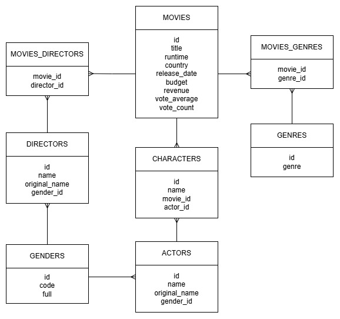

# TMDB Movies ETL

A Python ETL pipeline that extracts movie data from the [TMDB API](https://www.themoviedb.org/documentation/api), cleans and validates it with pandas, and loads it into a relational model in SQL Server.

## Pipeline overview

```
TMDB API  →  Extract (requests)  →  raw JSON  →  Transform (pandas)  →  Load (PYODBC)  →  SQL Server
```

1. **Extract:** paginated calls to the TMDB API, conversion of the nested JSON to a DataFrame, and storage of the data in `data/raw/movies.csv` for `movies`. In addition, some transformations were carried out to extract from the API only the information we were interested in from the extra movie data, and this was stored in `data/raw/extra_info.csv`.
3. **Transform:** type conversion, deduplication, null handling and range validation. For example, a `budget` or `revenue` of `0` in TMDB means "unknown", so it is stored as `NULL` instead of a real zero.
4. **Load:** insertion into the final tables.

## Data model



Main tables: `movies`, `genres`, `directors`, `actors`, `genders` and `characters`.

## Tech stack

Python · pandas · requests · pyodbc · SQL Server

## Project structure

```
src/        ETL notebooks
database/   SQL files and ER diagram
data/       processed data on actors, directors and genres
data/raw/   first movies info extract
```

## TO DO
 - Pipeline idempotent (running it twice does not duplicate data).
 - Error handling and retries on the API requests.
 - SQL queries on the database.
 - Logs every execution.
 - Unit tests for the cleaning steps.

---
*This product uses the TMDB API but is not endorsed or certified by TMDB.*